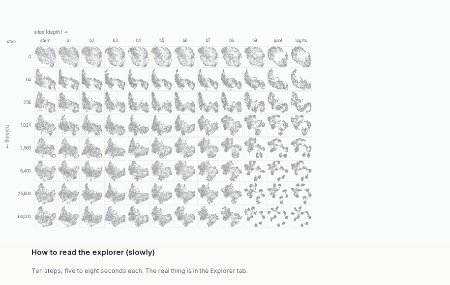
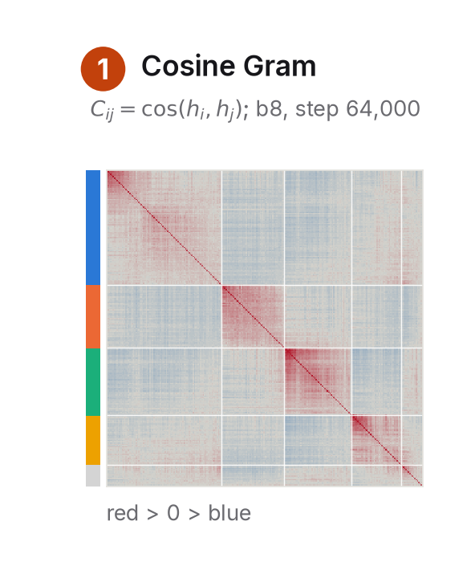

# Site design notes (for writers of content fragments)

The site is one page of hash-routed panels. The tab bar holds the **main text**: `#overview`, `#primer`, `#explorer`
(the centrepiece; its tab is marked), `#experiments` (was Findings, 2026-11-19), `#method`, and `#appendices` (an index
page). The **appendices** are their own panels, reached from that index and from a strip at the top of each
(`.appx-nav`); the "Appendices" tab stays highlighted while one is open (`APPENDICES` in `js/main.js`): A `#choices`
(Construction choices), B `#baselines` (Is the method sound? Baselines, nulls and stability), C `#method-details`
(Definitions and statistics), D `#measurements` (Reference charts), E `#reproduce`. The Alignment appendix was folded
into the experiments and appendices (EXPERIMENTS_PLAN.md section 3). `build_site.py <tag> [--layout-tag ...]
[--baselines r20s0c]` assembles `site/` into `viewer/site/` (deploy root, `.nojekyll`).

Curation rule (2026-11-19): the main text carries the argument; systematic charts and full definitions go in an
appendix. Within an appendix section, show one or two headline charts and put the other views of the same quantity
in `<details class="more"><summary>More views: ...</summary>` under them (live figures render when opened).

## Routing and old URLs (the site is published)

- `#<tab>`, `#<tab>/<id>` (scroll to the element with that id *inside that tab*), `#<id>` (finds the tab holding it),
  `#explorer?<params>` (explorer state, below). An unknown tab goes to the Overview; an unknown id on a known tab goes
  to that tab's top.
- Tab aliases (`TAB_ALIAS`): `questions` → `measurements`, `findings` → `experiments`, `alignment` → `experiments`.
  Anchor aliases are looked up under the tab *as written in the URL* before the tab alias applies, so
  `#findings/f-markov` goes to `#experiments/x-markov`. A bare `#f-markov` (no tab) also follows its alias row.
- Anchor aliases (`ANCHOR_ALIAS` in `js/main.js`) rewrite moved sections with `history.replaceState`, so back and
  forward skip the old URL. An alias applies only when the old id is no longer in the old tab, so links keep working
  while content moves; a target id that does not exist (yet) lands on its tab's top.

  | old | new |
  |---|---|
  | `overview/treated-alike` | `overview/procedure` |
  | `overview/blocks`, `overview/through-training` | `overview/step-3` |
  | `overview/hankel` | `choices/avgprod` |
  | `overview/kernel` | `method/kernel` |
  | `overview/reading` | `method/reading` |
  | `overview/panels` | `method/reading` |
  | `overview/limits`, `method/limits`, `method/checks` | `experiments` (tab top; open checks are per experiment) |
  | `findings/f-end-sets`, `f-looking-back`, `f-depth`, `f-block-vs-cell`, `f-gradients`, `f-coarse`, `f-markov` | `experiments/x-groups`, `x-when`, `x-depth`, `x-blocks`, `x-training-signal`, `x-coarse`, `x-markov` |
  | `findings/qualitative`, `findings/next-checks`, `findings/read-a-finding` | `experiments` |
  | `measurements/when`, `measurements/va` | `experiments/x-when` (once the old id leaves Appendix D) |
  | `measurements/carry`, `measurements/imgstats`, `measurements/gradients` | `experiments/x-depth`, `x-image-stats`, `x-training-signal` (same) |
  | `alignment/w1` | `measurements/ref-depth-w1` |
  | `alignment/w2` | `experiments/x-when` |
  | `alignment/w3` | `choices/w3` |
  | `alignment/w4`, `alignment/iso` | `baselines/w4`, `baselines/iso` |
  | `alignment/c1` | `experiments/x-across-nets` |
  | `alignment/c2` … `c5`, `alignment/modes` | `measurements/ref-across-nets-c2` … `-c5`, `measurements/ref-across-nets-modes` |
  | `method-details/reproduce` (and `method/reproduce`) | `reproduce` (Appendix E, tab top) |
  | `method/sweep`, `method/avgprod`, `method/product-blocks`, `method/umap`, `method-details/sweep`, `…/avgprod`, `…/product-blocks`, `…/umap`, `…/ablations`, `…/transfer` | `choices/<same id>` (by the generic rule below) |
  | `baselines/sources-files` | `reproduce/sources-files` (generic rule) |
  | `method/questions`, `method/stat-*`, `method/baselines-*`, `method/perimage` | `method-details/<same id>` (by the generic rule below) |
  | `method/glossary-cell` | `method/glossary-snapshot` |
  | `method/glossary-single-cell-block` | `method/glossary-single-snapshot-block` |

  Generic rule: a `#<tab>/<id>` whose id now lives in another panel goes to that panel (so moving a section with its
  id needs no alias). When you rename a section that may have been linked, add a row here and in `ANCHOR_ALIAS`. Never reuse an
  old id for something with a different meaning.

## How content is included

| fragment (writer-owned) | goes into | if missing |
|---|---|---|
| `site/content/overview.html` | Overview tab | a placeholder paragraph |
| `site/content/experiments/` | Experiments tab: `_lede.html`, a contents list generated from the manifest `index.json` (ordered `[{"id", "title"}]`), then `<id>.html` per entry (one `<section class="experiment" id="x-<id>">` each; template `_template.html`, worked example `markov.html`). Facts from `site/assets/x/<id>.facts.json` join the table as `x.<id>.<name>`. `--manifest NAME` uses `index.NAME.json` instead (a sub-list, e.g. `x7-only`) | a placeholder section per missing fragment (an error with `--release`) |
| `site/content/choices.html` | Appendix A, Construction choices (`#choices`) | a placeholder paragraph |
| `site/content/measurements.html` | Appendix D, Reference charts (`#measurements`; was `questions.html`) | a placeholder with the default decodability charts |
| `site/content/reproduce.html` | Appendix E, Reproduce (`#reproduce`) | a placeholder paragraph |
| `site/content/method.html` | Method tab | a placeholder paragraph |
| `site/content/method_details.html` | Appendix C, Definitions and statistics (`#method-details`) | a placeholder paragraph |
| `site/content/baselines.html` | Appendix B, Baselines and nulls (live figures `data-live="bn-*"`, `js/baselines.js`) | a placeholder paragraph |
| `site/content/header.json` (optional) | page header: `{"title", "subtitle", "short_title", "date", "description"?}`. The title is set large and balanced; the subtitle (e.g. "or, ...") sits under it in italics; `short_title` is the compact title in the tab bar on the other tabs; `description` is the `<meta>` description (default: title + subtitle). There is no "joke" line any more (a `joke` key is ignored). | the owner's title and subtitle, "Coherent sets in ResNet-20", today's date |
| `site/content/tours.json` (optional) | the explorer's Tours menu (see "Tours" below) | no menu |

The banner at the very top carries the one "Exploratory report" label for the whole site; fragments do not repeat it.

Fragments are plain HTML, no `<html>`/`<head>`/`<body>`, no `<script>`. They are inlined at build time into
`<article class="prose">`. Everything under `site/assets/` (figures from `make_figures.py` in `assets/fig/`,
`assets/questions.json` from `analysis.py`) is copied to `viewer/site/assets/`; reference it with relative URLs
(`assets/fig/pipeline.svg`), never absolute ones. Images get `loading="lazy"` automatically unless they set `loading`.

Fact names for per-rule numbers use both `rule<i>` (index in `meta.modes`) and a slug of the rule name (e.g. `kappa.rule3.final.mid_median` = `kappa.knn_scale.final.mid_median`); rules without a kappa give `n/a`.

Build-time numbers: write `{{fact:NAME}}` anywhere in a fragment (or in a tour's note) and the build substitutes the
value; it fails and lists the known names if NAME is unknown. `python3 site/build_site.py <tag> --facts` prints all
facts (kappa and 15-NN mass medians per rule, accuracies, checkpoint list, ...).

Facts from `analysis.py`: a flat object `assets/questions.json["facts"] = {name: value}` joins the table as
`q.<name>` on every build, including `--html-only` (write `{{fact:q.first_split_step}}`). Strings are used verbatim;
integers get thousands separators (`2560` becomes `2,560`); other numbers get 3 significant figures. Give a formatted
string whenever the formatting matters (percentages, intervals, a year). A missing key adds nothing.

## Type and layout

- Prose: Source Serif 4, 18 px, measure ~ 68 ch (`.prose` column, 700 px). UI and figure text: Inter. Code: JetBrains Mono.
- Headings: `h2` for sections (each gets an anchor link automatically if it has an `id`), `h3` for subsections.
  Give every `h2`/`h3` an `id`; link to it from anywhere as `href="#overview/kappa"` (tab, slash, id).
- `<p class="lede">`: the opening paragraph, slightly larger.
- `<p class="byline">`: small grey line, e.g. under a section title.

## Patterns

Figure with caption. Captions are definitional (the caption policy in `REORG_PLAN.md`): a **Plotted:** part (each
axis, mark and colour as defined quantities with symbols; block, kernel rule, r or k, checkpoints, sort order, null)
and an optional **Values:** line with the main quantities only. No class make-up, no "clear"/"persists", no "what it
shows"; interpretation belongs in the experiment's Answer, as measured statements.
```html
<figure class="fig">
  
  <figcaption><b>Plotted:</b> ... <b>Values:</b> ...</figcaption>
</figure>
```
Width modifiers on `figure.fig`: none (prose width, 700 px), `wide` (up to 1040 px, centred, breaks out of the
column), `full` (up to 1400 px). Side by side: wrap figures in `<div class="fig-row">` (stacks below 760 px).

Gif with a play/pause control (starts paused, on the still, when the reader prefers reduced motion). The explorer
how-to gif (`assets/fig/howto.gif`) lives in the explorer's own "How to use" panel, not in prose:
```html
<figure class="fig wide">
  
  <figcaption>...</figcaption>
</figure>
```

Maths: KaTeX auto-render. Inline `$\psi_k$` or `\(\psi_k\)`; display `$$ ... $$` or `\[ ... \]`.
Numbered display equation: `<div class="eq" id="eq-penalty" data-num="1">$$ ... $$</div>`; refer to it with
`<a href="#overview/eq-penalty">(1)</a>`. A literal dollar sign is `\$`.

A numbered step with its picture beside it (the Overview's procedure): the picture floats right at width `--w`
(default 45%) and goes full width below 640 px; the link opens the full-size image.
```html
<div class="step">
<h3 id="step-1">1. Compare images within one snapshot</h3>
<a class="step-fig" style="--w: 32%" href="assets/fig/step1.png" target="_blank" rel="noopener"></a>
<p>...</p>
<details class="more"><summary>The maths</summary> ... </details>
</div>
```

Callouts (`p.callout-title` optional):
```html
<aside class="callout">...</aside>              <!-- neutral note -->
<aside class="callout key">...</aside>          <!-- the one thing to take away -->
<aside class="callout caveat">...</aside>       <!-- limitation / honest caveat -->
```

Side note (a margin note at >= 1240 px wide, an inline numbered expandable note below that):
```html
... the kernel is nearly flat<span class="sidenote">At kappa = 1.2 the kernel weight at the median
pairwise distance is still e^{-1.2} = 0.3.</span> in the middle layers ...
```

Collapsible detail: `<details class="more"><summary>Why Sinkhorn?</summary> ... </details>`.

Tables: `<table class="data">` (numbers right-aligned with `class="num"` on `td`/`th`).

Deep link into the explorer (opens the Explorer tab in that state):
```html
<a class="explore-link" href="#explorer?fam=layer&t=7&a=3&b=9&m=2&c=seba&r=4">see this block in the explorer</a>
```
Parameters (all optional): `fam` = `layer` | `time`; `t` = checkpoint index (layer blocks) or site index (time
blocks); `a`, `b` = first and last site index (layer) or checkpoint index (time), 0-based, see `meta.json`;
`m` = kappa mode index; `c` = `seba` | `nodal` | `eig` | `class` | `loss` | `correct` | `jac` | `gcos` | `gdot` |
`px:<stat>` (a per-image pixel statistic, `<stat>` one of `mean_r mean_g mean_b luminance contrast saturation bc_r
bc_g bc_b bc_lum bc_dist hf_frac`; write `px%3Aluminance` or `px:luminance` in a link);
`k` = eigenfunction 1..8 (1..32 where the coarse add-on ships, below); `km` = number of spectral k-means blocks
(2..16, with `c=km`), `kms` = `end` for the end-side partition of a multi-site layer block (default start); `r` = SEBA rank (2, 3, 4, 6, 8); `j` = focused set (0-based); `src` = "Sets from" source
id (`M0` default, `L1 L2 L3 G1 G1n G2 C1first C1mid C1last C2 C3 I1 I2 I3 Y1 Y2 N3 N2a N2b N4 N5`, `js/sources.js`;
kernel rule 0 and the average operator only; an unavailable source falls back to `M0` with a status message); `at` = `own` | `final`
(for per-image diagnostics); `lay` = `0` | `1` (which seed's UMAP lays out the points); `tour` = a tour id (below).
`c=depth` is the through-depth colouring (below) with `dv` = `own` | `none` | `paper`, `dt` = coupling index 0..5
(t = t* x 1/64, 1/16, 1/4, 1, 4, 16; omitted for `paper`), `dm` = mode 1..16 or `sets` (then `dk` = 5 | 10, `dr` = `a`
shape-aligned | `s` shared coordinates, `j` = isolated set), `ds` = site of the images card (default: the site holding
most of the mode, or of the space for sets); `t` is the checkpoint row. Also read (never written): `dv=rel` | `native`,
`dc` for `dt`, `dm=s5` | `s10` for sets with that k.

## The explorer

- Wording follows the glossary (`#method/glossary`): snapshot (a checkpoint and a site; never "cell", which means activation cells), panel (a
  picture in the grid), layer block / time block / single-snapshot block, kernel rule,
  block operator $\bar M$, lazy walk $M_c$, eigenfunction $\psi_k$, spectrum, retention $\rho_c$, SEBA vector,
  coherent set, unassigned, matched Jaccard. Keep new UI text in these terms.
- The first side-panel card (beside the grid at desktop widths, so visible without scrolling; full width right under
  the grid below 1100 px) shows the selection's images. For coherent sets: one row per set with its colour, size,
  a stacked bar of its CIFAR class make-up (labelled validation only; hover for the counts; class key below) and a
  strip of its highest-membership images, plus the unassigned images' size and make-up. Clicking a set selects it
  (two rows of images and its boundary members; with the SEBA colouring it also isolates the set in the grid). For
  an eigenfunction: its most negative, most positive and nearest-zero images. Images are the build-time
  representatives (`D.reps`), the same ones the `images` live figure uses. With the SEBA colouring the Legend card
  keeps only the matched-Jaccard comparisons.
- Under the grid, a generated caption states the block (family, anchor, range), the kernel rule, the colouring (with
  r or k, draw order, what grey means) and the layout. It is definitional and is built by `captionParts()` in
  `js/explorer.js`; change that function, not prose, when the explorer's definitions change.
- "Image statistics (pixels)" in Colour by: the per-image statistics of `assets/questions.json` →
  `q_imgstats.per_image` (definitions in `analysis_findings.py`, section 3; short ones in `IMGSTATS` in
  `js/explorer.js`, which must list any new statistic). The large JSON is fetched only when one of these is first
  chosen. Signed border − centre statistics use a symmetric diverging scale (±99th percentile of |value|), the others a
  sequential scale from the 1st to the 99th percentile. They also work as `data-c` of a `cells` live figure.
- "How to use": a disclosure above the grid with the how-to gif and a short guide; open on the first visit, collapsed
  after that (`localStorage["cm.explorer.howto-seen"]`), and toggled by the "How to use" button in the bar.

### Tours

`site/content/tours.json` is a list of named explorer states, shown in the Tours menu of the explorer bar:
```json
[{"id": "late-layers", "label": "Late layers at the end of training",
  "hash": "#explorer?fam=layer&t=7&a=7&b=10&m=0&c=seba&r=4",
  "note": "Layer block: sites b7 to pool at the final checkpoint (step {{fact:final_step}}). ..."}]
```
`id`: unique lower-case slug (a-z, 0-9, -). `label`: menu text. `hash`: an explorer link (must start with
`#explorer?`, without `tour=`). `note`: about two definitional lines, HTML and `$...$` maths allowed, `{{fact:...}}`
substituted. The build validates the file and fails with a message if it is malformed. A tour is a URL,
`#explorer?tour=<id>`: it applies exactly the tour's parameters (others in the same URL are ignored) and shows the
note above the grid. Link to one from prose with `<a class="explore-link" href="#explorer?tour=late-layers">`. Once
the reader changes the view, the URL drops `tour=` and the note dims with a "back to this tour's view" button.

### Sets from (baselines study)

`build_site.py ... --baselines r20s0c` runs `site/baselines.py`: per-block chunks `d/src/<fam>/<anchor>/<pair>.bin.gz`
(nibble-packed labels of the stored sources, then f32 agreement rows; layout in `d/src/index.json`), `d/src/i1.bin`,
`d/src/rep/<id>.bin` (stored null draws of the representative blocks) and the tab's `d/bn/*.json`. The registry of
sources (label, status tag, definition) is `js/sources.js`; the side card's agreement box is `agreementBox()` in
`js/explorer.js`. Where every number comes from: `explore/cifar_baselines/NOTES_SITE.md`.

### Alignment data (spectral-alignment study; the Alignment tab was dissolved 2026-11-19)

`build_site.py ... --alignment ../spectral_align/data` (or `data_fixture`) runs `site/alignment.py`: it reuses or
reruns `explore/spectral_align/analyze.py` (output in `explore/spectral_align/analysis/<data dir name>/`, rerun when
the data directory's stamp changes; needs torch and dtw-python, see the command in `alignment.py`), copies it to
`d/al/` and adds the `al.*` facts. Its live figures, `data-live="al-w1"` .. `"al-w4"` and `"al-c1"` .. `"al-c5"`
(`js/alignment.js`, no attributes), now sit in X8 (`al-c1`) and the appendices (A `w3`, B `w4` and
`iso`, D `ref-depth-w1` and `ref-across-nets-*`); the data notes are in Appendix E (`rp-alignment`). Without the
flag those figures show a placeholder line; `--release` requires it. Data layout: `analyze.py`'s docstring. A
fixture build says so in `al.data_note`.

## Live mini-figures

A `figure.fig.live` with a `data-live` attribute is rendered by the site's JS when it scrolls into view (data
are fetched lazily). Put a `<figcaption>` inside it as for any figure; the JS inserts the chart before it.

`data-live="cells"` (the identifier is unchanged): a strip of panels, one UMAP layout per snapshot, coloured by a block (same renderer and hover as the explorer).
```html
<figure class="fig wide live" data-live="cells" data-cells="7:0,7:4,7:8,7:11"
        data-fam="layer" data-t="7" data-a="4" data-b="9" data-m="2" data-c="seba" data-r="4">
  <figcaption>...</figcaption>
</figure>
```
`data-cells` lists `checkpoint_index:site_index` pairs, one per snapshot (default: the block's own snapshots). An out-of-range block, `r`
or `k` shows an error in place of the figure. Colour parameters are
the explorer link parameters above. `data-size` = panel size in px (default 150).

`data-live="images"`: a grid of probe-image thumbnails for one coherent set, or for one end of an eigenfunction, of
one block. Same images and order as the explorer's "Representative images" panel (computed at build time from
full-precision vectors). Hover shows the image index and its class.
```html
<figure class="fig live" data-live="images" data-fam="layer" data-t="7" data-a="7" data-b="10" data-m="0"
        data-r="4" data-j="1" data-n="24">
  <figcaption><b>Plotted:</b> ...</figcaption>
</figure>
<figure class="fig live" data-live="images" data-fam="layer" data-t="7" data-a="7" data-b="10" data-m="0"
        data-k="1" data-end="neg" data-n="12"><figcaption>...</figcaption></figure>
```
Block parameters as for an explorer link (`data-fam`, `data-t`, `data-a`, `data-b`, `data-m`). A set: `data-r` and
`data-j` (0-based set index, in the explorer's set order); `data-pick` = `top` (default: highest SEBA value first) |
`boundary` (smallest lead over the runner-up set first) | `random` (uniform over the set's members, fixed seed). An
eigenfunction: `data-k` (1..8) with `data-end` = `pos` (default, most positive first) | `neg` | `zero` (nearest zero).
`data-n` = number of thumbnails (default 12, up to 400; past the stored 24 per set or 12 per end of $\psi_k$ the
order is continued in the browser from the 8-bit vectors); `data-size` = minimum thumbnail size in px (default 40).
A one-line generated label above the grid names the set or end, its size and the block.

`data-live="kernel"`: interactive kappa slider showing vMF kernel weight exp(kappa (c - 1)) against cosine
distance, with the measured 15th-neighbour and median pairwise distances of one snapshot marked.
Attributes: `data-t`, `data-s` (with `data-t`, the snapshot), `data-m` (initial rule).

`data-live="lines"` and `data-live="heatmap"`: charts from a JSON object, normally in `assets/questions.json`.
`data-src="assets/questions.json#path.to.object"` (dot path into the JSON).
- lines object: `{"x": [...], "xlabel": str, "ylabel": str, "xscale": "linear"|"log"|"symlog",
  "yrange": [lo, hi] (optional, fixed axes preferred), "series": [{"name": str, "y": [...], "dash": bool?,
  "band": [[lo...],[hi...]]?, "color": css?, "width": px?, "dots": radius? (point markers), "noline": bool? (markers
  only, e.g. validation markers), "dash": true (dashed: a control) | "dot" (dotted: a scale reference)?}],
  "xticklabels": [str...]? (categorical x, e.g. adjacent site pairs), "band": [[lo...],[hi...]]? (one band for the whole chart), "band_label": str?,
  "band_mode": "auto"|"each"|"shared"|"envelope"|"none"?, "colors": "ordinal"|"categorical"|"classes" (default categorical; ordinal = one
  hue light to dark, for ordered series such as checkpoints or sites), "refline": {"y": v, "label": str}?}`.
  Hover shows every series' value at the nearest x. Bands: a chart-level `band` is drawn once in grey. Per-series
  bands follow `band_mode`: `each` (each in its series colour), `shared` (the first, once, in grey), `envelope` (one
  grey band from the lowest to the highest band; hovering a series' key shows its own band), `none`; the default
  `auto` is `shared` when all bands are equal, `each` for up to three banded series, else `envelope`. The legend
  says what the grey band is (`band_label` overrides the text).
  Optional on the figure: `data-ceiling-src="assets/questions.json#q_when.0_4.vs_class_ceiling"` draws a horizontal
  reference line at the maximum finite value of that object's `z` (or `y`), labelled by `data-ceiling-label`.
- heatmap object: `{"rows": [...], "cols": [...], "z": [[...]] or [[[...]]], "zlabel": str, "zrange": [lo, hi],
  "rowlabel": str, "collabel": str, "slider": {"label": str, "values": [...]}?, "diverging": bool?, "fmt": str?}`;
  with a slider, `z` is indexed `[slider][row][col]`. Column labels that do not fit their columns (class names) are
  rotated 45 degrees; every column label shows its full name on hover. Hover shows the value; the slider steps through e.g.
  checkpoints. Values (hover and colour-bar ends) print as integers when every `z` is an integer (counts), else to
  3 significant figures; `"fmt"` overrides: `"int"`, `"pct"` (×100, with %), `"<n>f"` (n decimals) or `"<n>g"`
  (n significant figures).

Measurement JSON is also served: `d/decod.json`, `d/curves.json`, `d/avgprod.json`, `d/normalisation_compare.json`, `d/sweep.json` (when present), `d/meta.json`, `d/facts.json`; a lines/heatmap object can live in any of them, but the usual place is `assets/questions.json` from `analysis.py`.

`data-live="decod"` and `data-live="curves"`: the default decodability and training-curve charts (no attributes).

## Experiments: generators, validator, release build (EXPERIMENTS_PLAN.md section 4)

- Generator `site/experiments/<id>.py` (run with `python -I`; imports `site/xlib.py` after an explicit `sys.path`
  insert) writes only `site/assets/x/<id>.json` (chart objects, `data-src="assets/x/<id>.json#<key>"`),
  `site/assets/x/<id>.facts.json` and `site/assets/fig/x_<id>_*.png`. Charts for Appendix D go under the key `app4`,
  each with a `caption`.
- `python3 site/check_fragment.py <id> [--strict]` validates an experiment fragment, and
  `python3 site/check_fragment.py --appendix <name>` an appendix (choices, baselines, method-details, measurements,
  reproduce: facts incl. every `x.<id>.*`, page-global id clashes, `#<tab>/<id>` link targets, data-src, captions;
  for measurements, every experiment's `app4` panel shown), without building. Facts come from
  `site/build_inputs/facts_base.json` (the non-`x.` facts of a full build; gitignored, a local snapshot for agents
  validating while a build runs) or, if that is missing, from `viewer/site/d/facts.json`.
- `build_site.py ... --release [--manifest NAME]` fails on a missing fragment, an unknown fact, a missing `data-src`
  target or image, or missing alignment data.
- `python3 site/check_browser.py [--session NAME]` serves the built site on loopback, checks every live figure of the
  Experiments tab renders, screenshots it (desktop and mobile, `/tmp/x-check/`), and follows every alias row;
  `--capture-explorer <id>` takes the experiment's explorer screenshot from its `figure.explorer-shot` link.

## Colour grammar (tokens in `site/palette.json`, used by JS, CSS and `make_figures.py`)

- `classes`: 10 CIFAR classes (cool hues = vehicles, warm/green = animals). Labels only ever colour and validate.
- `sets`: SEBA sets in reliability order (set 1 = most reliable); `unassigned` grey.
- `diverging` (`neg`, `mid`, `pos`): eigenfunctions and signed loadings; nodal domains use `neg`/`pos`.
- `sequential`: one-hue ramp, light to dark, for magnitudes (loss, Jacobian norm, R^2, Jaccard).
- `ordinal`: one-hue ramp for ordered series (checkpoints, sites) in line charts.
- Ink and surfaces: `fg`, `mute`, `line`, `bg`, `surface`. Text never takes a data colour.
CSS custom properties with the same names (`--c-class-0`, `--c-set-0`, `--c-neg`, ...) are available in fragments,
e.g. `<span class="swatch" style="--sw: var(--c-set-0)"></span>` for an inline key swatch.

## Building and previewing

```bash
uv run --with numpy --with pillow python site/build_site.py <tag> [--layout-tag r20s1b]   # full build (incremental)
uv run --with numpy --with pillow python site/build_site.py <tag> --html-only             # after editing content/, css/, js/, assets/: ~1 s
python3 -m http.server 8765 --bind 127.0.0.1 -d viewer/site                               # http://127.0.0.1:8765/
```
Block chunks are rebuilt only when their source `.npz` changes (`--clean` forces everything). `--facts` lists the
`{{fact:NAME}}` values of the last build. The page works only over HTTP (it fetches data), not from `file://`.
`python3 -m http.server` sends no cache headers, so Chrome may keep serving old `js/*.js` after a rebuild: reload with
the cache disabled, or close and reopen the browser session (`playwright-cli -s=<name> close`).

**Dot-kernel root** (SPEC_DOT.md section 5). `--dot-tag r20s0d` also builds `viewer/site/d_dot/` from the dot-kernel
measurement (same formats as `d/`: `meta.json` with `"kernel": "dot"`, `umap_0.bin` = seed-0 layout Procrustes-rotated
onto the cosine one, `umap_1.bin` = spectral, `blk/`; labels, sprite and points are checked equal to the cosine tag's
and read from `d/`). `--dot-rules auto` (default) ships every rule unless the projected site passes 800 MB, then rules
0-1 only (`meta.modes` is trimmed, `modes_all` keeps the full list); `all` or a number overrides. `viewer/site/kernels.json`
(written by every build) points the explorer at the second root, only if its `meta.shared_fingerprint` (grid, probe.npz
arrays, per-image data) equals `d/`'s, so a preserved `d_dot/` built from another probe is never offered. A cosine rebuild
never deletes `d_dot/` (`--clean` included); `--dot-tag X --dot-only` rebuilds `d_dot/` and `kernels.json` only and exits
with an error if anything under `d/` changed. A kernel switch commits the new context, block, layout, badge and hash
together once all have loaded; a failed load reverts to the kernel on screen. In the explorer the Kernel switch (more options, hash
`kern=dot`, localStorage `cm.explorer.kernel`) swaps the context of `explorer.js` (`context(kernel)`, one per root):
blocks, spectra, kappa, retention, products and layouts come from it; Sets from, seed 1 and unshipped rules are disabled
under dot; prose figures, Baselines and Alignment always read `d/`.

**Coarse-graining add-ons** (SPEC_COARSE.md sections 3 and 5; cosine root, layer blocks only). When
`data/<tag>/coarse/coarse_<step>_<rule>.npz` and `data/<tag>/coarse_summary.json` exist, `build_site.py` (`coarse()`)
writes three lazily loaded parts of `d/`, described in `meta.coarse` and stamped in `d/coarse/index.json` (kept between
builds like `blk/`): `ext/<fam>/<t>/<rule>/<pair>.bin.gz` (ψ9..ψ32 and the values λ/σ 0..32 of the layer average
`layer` and of the product's start/end sides `layerprodR`/`layerprodL`, int8 with the `blk/` quantisation; a single cell
is stored once, under `layer`); `km/<step>_<rule>/<pair>.bin.gz` (spectral k-means partitions k = 2..16, 4 bits per
image, start side then end side, groups numbered by decreasing size); `coarse/<step>_<rule>.json.gz` (per block: top-65
spectrum of the product and of the average, F_k, gap reports, the χ² scores of every partition method, 4 significant
digits). The `blk/` format and `n_vecs` are unchanged (the dot root needs equal `n_vecs`). If ψ9..ψ32 for every rule
would pass 300 MB gzipped, multi-site blocks ship (ψ9..ψ32 and k-means labels) for the default rule only and single
cells for every rule; `meta.coarse.ext.note` says which. In the explorer: the ψ selector offers ψ1..ψ32 where the add-on
exists (otherwise ψ is clamped to 8 with a status note; per-snapshot retention, gains and the all-blocks map are not
shipped for ψ>8 and say so; representative images for ψ>8 are ranked in the browser from the 8-bit vector); the block
card has a top-64 spectrum strip (log scale, gap marker, dashed when there is no clear gap); the coarse-graining card
plots retained χ² information vs the number of occupied blocks (spectral k-means, SEBA, PCA k-means, random null,
labels and predictions as validation markers) against the ceiling F_k, with an efficiency view and, for single cells,
leakage over the Ky Fan and Cheeger bounds; clicking k there colours the grid by that k-means partition (`c=km`).
All of this is hidden under the dot kernel.

**Diffusion wavelets add-on** (2026-11-21; cosine root, kernel rule 0, single snapshots only). `wavelets_modal.py`
(Modal CPUs, about 0.2 container-hours) runs `wavelets.py` (Coifman & Maggioni 2006) on every snapshot's stored lazy
walk M: level j holds M^(2^j) on an orthonormal scaling basis Φ_j (Φ_0 = deltas); a QR with column pivoting keeps the
columns with |R_kk| > ε = 1e-4 and gives Φ_{j+1}; the wavelets Ψ_j are a pivoted-QR basis of the complement. Each
function's centre is the delta it descends from through the pivots. The functions are **not sparse** here (median
participation ratio tens of images, but ~1,400 of 2,000 entries above 8-bit resolution), so only the first 64 wavelets
per level in pivot order (a subset; pivot order is not a localization ranking) and the scaling functions of levels with at most 64 are stored. When
`data/<tag>/wavelets/dw_<step>_<site>.npz` exists for every snapshot, `build_site.py` (`wavelets()`, or alone with
`--wavelets-only`) checks each snapshot's eigenvalues against the stored single-cell block (the build fails on a
mismatch) and writes `d/dw/<step>_<site>.bin.gz` (u32 H, H bytes of JSON level/function tables, f32 scales, i8 vectors;
about 36 MB in all), described in `meta.dw` and stamped in `d/dw/index.json`. In the explorer, Colour by "diffusion
wavelets" (`c=dw&dwj=<j>&dwk=<1 wavelet|0 scaling>&dwi=<image>|dwf=<index>`) forces the cosine kernel, rule 0 and a
single snapshot; a click picks the clicked panel's snapshot and image, and the stored function of the chosen scale with the
largest |f(i)| relative to its own peak (precomputed at full precision: `u8 win` per level and kind) is painted on every panel. The side panel shows its two ends and centre, and a
card with n_j, the wavelet count and #{λ^(2^j) > ε} per scale (click to change scale).

**Through-depth add-on** (SPEC_SPACETIME.md sections 2, 4 and 6; cosine root, kernel rule 0 only). When
`data/<tag>/spacetime/st_<step>_0.npz` exists for every checkpoint (`spacetime_stage.py`), `build_site.py`
(`spacetime()`) checks each unit's `probe_idx` against `probe.npz` (the build fails on a mismatch) and writes `d/st/`,
described in `meta.spacetime` and stamped in `d/st/index.json` (kept between builds like `blk/`):
`st/<step>_<variant>.bin.gz` for `own` (relative site units), `none` (native walk units) and `paper` (the paper's
transition matrix): int8 unit slices (C, 16 modes, 12 sites, N), `round(127 u / max|u|)` with the non-zero floor, C = 6
couplings (1 for paper), then the four set readouts (k = 5, 10 x shape-aligned, shared coordinates) as 4-bit labels
(value + 1, 0 = no label), sets renumbered by decreasing size over all sites (display only); and `st/<step>.json.gz`
(per variant: t, values, depth weight, neighbour cosines, retention, own share, occupancy, scalar control, set groups and
churn, alignment links; 4 significant digits). About 39 MB gzipped; nothing is fetched until the colouring is used, then
one checkpoint and variant at a time (`D.depthUnit`, `D.depthSummary` in `js/data.js`).

In the explorer, Colour by "through depth" colours one checkpoint row (click any panel to pick it; a click in the
coloured row picks the site of the images card); every other row is light grey. Each site's panel shows its own slice
of the selected mode (diverging, scaled to max|u_l| = 1, one sign for the whole mode) or the set labels (shared
centroids: one colour is one centroid at every site; grey = no label). A slice holding under 1% of its mode's squared
norm (`meta.spacetime.low_weight`) is drawn in uniform grey with a "< 1% of mode" note. Controls: variant, coupling
slider (t/t* and t; hidden for paper), mode 1..16 or sets k = 5 / 10 with the readout. While it is on, the kernel and
rule are fixed to cosine / kNN graph (a visible badge; the Kernel switch and rule menu are disabled), the layer family is
used, and the block-only cards (eigenvalues, coarse-graining, retention, per-snapshot table) are hidden by the
`.ex.depth` class; an incompatible link (dot kernel, another rule, a time block, out-of-range values) is fitted and
announced in the status line (`fitDepth()`). The first card shows the two ends of the slice (or the sets' class make-up)
at one site; the "through depth" card shows the mode's depth weight with the scalar control for mode 1, neighbour
cosines, retention and own share (left out at sub-1% sites), the low space's occupancy, and the 16 values; for sets, the
number of sets per site, churn and alignment strength. Its caption says mode numbers are local to a setting and that
mode 1's depth weight mostly follows the sites' gaps. Without the add-on the menu entry is removed. `check_browser.py`
smoke-tests it (`--no-depth` skips; `--tabs "" --no-aliases` runs it alone).
