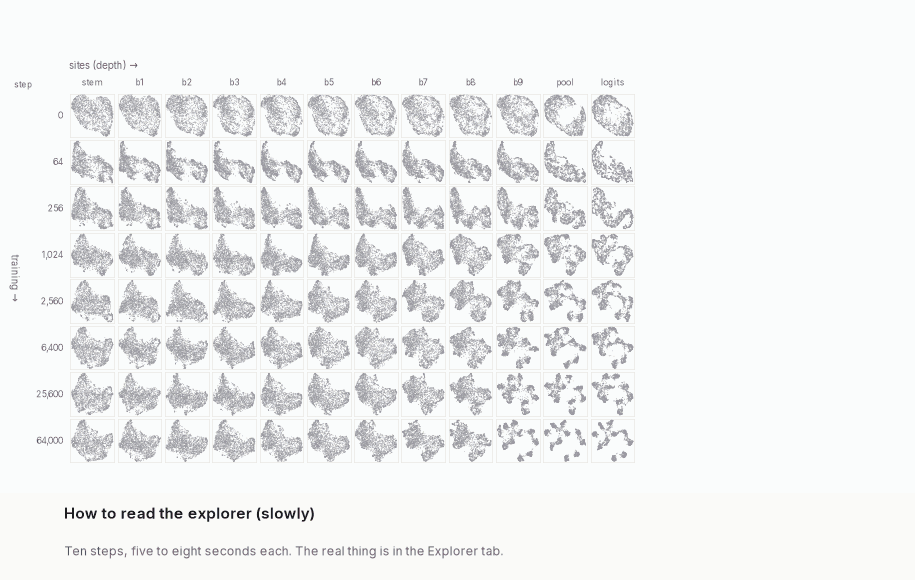
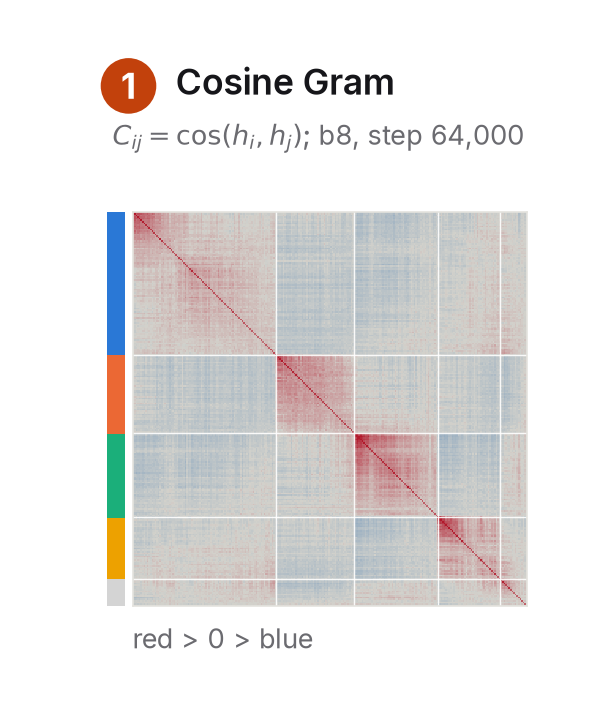

# Site design notes (for writers of content fragments)

The site is one page with five hash-routed tabs, in this order: `#overview`, `#explorer` (the centrepiece; its tab
is marked), `#findings`, `#measurements`, `#method`. `build_site.py <tag> [layout_tag]` assembles `site/` into
`viewer/site/` (deploy root, `.nojekyll`).

## Routing and old URLs (the site is published)

- `#<tab>`, `#<tab>/<id>` (scroll to the element with that id *inside that tab*), `#<id>` (finds the tab holding it),
  `#explorer?<params>` (explorer state, below). An unknown tab goes to the Overview; an unknown id on a known tab goes
  to that tab's top.
- `questions` is an alias of `measurements`: `#questions/when` is rewritten to `#measurements/when`.
- Anchor aliases (`ANCHOR_ALIAS` in `js/main.js`) rewrite moved sections with `history.replaceState`, so back and
  forward skip the old URL. An alias applies only when the old id is no longer in the old tab, so links keep working
  while content moves; a target id that does not exist (yet) lands on its tab's top.

  | old | new |
  |---|---|
  | `overview/treated-alike` | `overview/procedure` |
  | `overview/blocks`, `overview/through-training` | `overview/step-3` |
  | `overview/hankel` | `method/avgprod` |
  | `overview/kernel` | `method/kernel` |
  | `overview/reading` | `method/reading` |
  | `overview/panels` | `method/reading` |
  | `overview/limits`, `method/limits` | `method/checks` |
  | `method/glossary-cell` | `method/glossary-snapshot` |
  | `method/glossary-single-cell-block` | `method/glossary-single-snapshot-block` |

  When you move or rename a section that may have been linked, add a row here and in `ANCHOR_ALIAS`. Never reuse an
  old id for something with a different meaning.

## How content is included

| fragment (writer-owned) | goes into | if missing |
|---|---|---|
| `site/content/overview.html` | Overview tab | a placeholder paragraph |
| `site/content/findings.html` | Findings tab | a placeholder paragraph |
| `site/content/measurements.html` | Measurements tab (was `questions.html`) | a placeholder with the default decodability charts |
| `site/content/method.html` | Method tab | a placeholder paragraph |
| `site/content/header.json` (optional) | page header: `{"title", "subtitle", "short_title", "date", "description"?}`. The title is set large and balanced; the subtitle (e.g. "or, ...") sits under it in italics; `short_title` is the compact title in the tab bar on the other tabs; `description` is the `<meta>` description (default: title + subtitle). There is no "joke" line any more (a `joke` key is ignored). | the owner's title and subtitle, "Coherent sets in ResNet-20", today's date |
| `site/content/tours.json` (optional) | the explorer's Tours menu (see "Tours" below) | no menu |

The banner at the very top carries the one "Exploratory report" label for the whole site; fragments do not repeat it.

Fragments are plain HTML, no `<html>`/`<head>`/`<body>`, no `<script>`. They are inlined at build time into
`<article class="prose">`. Everything under `site/assets/` (figures from `make_figures.py` in `assets/fig/`,
`assets/questions.json` from `analysis.py`) is copied to `viewer/site/assets/`; reference it with relative URLs
(`assets/fig/pipeline.svg`), never absolute ones. Images get `loading="lazy"` automatically unless they set `loading`.

Fact names for per-rule numbers use both `rule<i>` (index in `meta.modes`) and a slug of the rule name (e.g. `kappa.rule3.final.mid_median` = `kappa.knn_scale.final.mid_median`); rules without a kappa give `n/a`.

Build-time numbers: write `{{fact:NAME}}` anywhere in a fragment (or in a tour's note) and the build substitutes the
value; it fails and lists the known names if NAME is unknown. `python3 site/build_site.py <tag> --facts` prints all
facts (kappa and 15-NN mass medians per rule, accuracies, checkpoint list, ...).

Facts from `analysis.py`: a flat object `assets/questions.json["facts"] = {name: value}` joins the table as
`q.<name>` on every build, including `--html-only` (write `{{fact:q.first_split_step}}`). Strings are used verbatim;
integers get thousands separators (`2560` becomes `2,560`); other numbers get 3 significant figures. Give a formatted
string whenever the formatting matters (percentages, intervals, a year). A missing key adds nothing.

## Type and layout

- Prose: Source Serif 4, 18 px, measure ~ 68 ch (`.prose` column, 700 px). UI and figure text: Inter. Code: JetBrains Mono.
- Headings: `h2` for sections (each gets an anchor link automatically if it has an `id`), `h3` for subsections.
  Give every `h2`/`h3` an `id`; link to it from anywhere as `href="#overview/kappa"` (tab, slash, id).
- `<p class="lede">`: the opening paragraph, slightly larger.
- `<p class="byline">`: small grey line, e.g. under a section title.

## Patterns

Figure with caption. Captions are definitional (the caption policy in `REORG_PLAN.md`): a **Plotted:** part (each
axis, mark and colour as defined quantities with symbols; block, kernel rule, r or k, checkpoints, sort order, null)
and an optional **Values:** line with the main quantities only. No class make-up, no "clear"/"persists", no "what it
shows"; interpretation belongs in Findings.
```html
<figure class="fig">
  
  <figcaption><b>Plotted:</b> ... <b>Values:</b> ...</figcaption>
</figure>
```
Width modifiers on `figure.fig`: none (prose width, 700 px), `wide` (up to 1040 px, centred, breaks out of the
column), `full` (up to 1400 px). Side by side: wrap figures in `<div class="fig-row">` (stacks below 760 px).

Gif with a play/pause control (starts paused, on the still, when the reader prefers reduced motion). The explorer
how-to gif (`assets/fig/howto.gif`) lives in the explorer's own "How to use" panel, not in prose:
```html
<figure class="fig wide">
  
  <figcaption>...</figcaption>
</figure>
```

Maths: KaTeX auto-render. Inline `$\psi_k$` or `\(\psi_k\)`; display `$$ ... $$` or `\[ ... \]`.
Numbered display equation: `<div class="eq" id="eq-penalty" data-num="1">$$ ... $$</div>`; refer to it with
`<a href="#overview/eq-penalty">(1)</a>`. A literal dollar sign is `\$`.

A numbered step with its picture beside it (the Overview's procedure): the picture floats right at width `--w`
(default 45%) and goes full width below 640 px; the link opens the full-size image.
```html
<div class="step">
<h3 id="step-1">1. Compare images within one snapshot</h3>
<a class="step-fig" style="--w: 32%" href="assets/fig/step1.png" target="_blank" rel="noopener"></a>
<p>...</p>
<details class="more"><summary>The maths</summary> ... </details>
</div>
```

Callouts (`p.callout-title` optional):
```html
<aside class="callout">...</aside>              <!-- neutral note -->
<aside class="callout key">...</aside>          <!-- the one thing to take away -->
<aside class="callout caveat">...</aside>       <!-- limitation / honest caveat -->
```

Side note (a margin note at >= 1240 px wide, an inline numbered expandable note below that):
```html
... the kernel is nearly flat<span class="sidenote">At kappa = 1.2 the kernel weight at the median
pairwise distance is still e^{-1.2} = 0.3.</span> in the middle layers ...
```

Collapsible detail: `<details class="more"><summary>Why Sinkhorn?</summary> ... </details>`.

Tables: `<table class="data">` (numbers right-aligned with `class="num"` on `td`/`th`).

Deep link into the explorer (opens the Explorer tab in that state):
```html
<a class="explore-link" href="#explorer?fam=layer&t=7&a=3&b=9&m=2&c=seba&r=4">see this block in the explorer</a>
```
Parameters (all optional): `fam` = `layer` | `time`; `t` = checkpoint index (layer blocks) or site index (time
blocks); `a`, `b` = first and last site index (layer) or checkpoint index (time), 0-based, see `meta.json`;
`m` = kappa mode index; `c` = `seba` | `nodal` | `eig` | `class` | `loss` | `correct` | `jac` | `gcos` | `gdot` |
`px:<stat>` (a per-image pixel statistic, `<stat>` one of `mean_r mean_g mean_b luminance contrast saturation bc_r
bc_g bc_b bc_lum bc_dist hf_frac`; write `px%3Aluminance` or `px:luminance` in a link);
`k` = eigenfunction 1..8; `r` = SEBA rank (2, 3, 4, 6, 8); `j` = focused set (0-based); `at` = `own` | `final`
(for per-image diagnostics); `lay` = `0` | `1` (which seed's UMAP lays out the points); `tour` = a tour id (below).

## The explorer

- Wording follows the glossary (`#method/glossary`): snapshot (a checkpoint and a site; never "cell", which means activation cells), panel (a
  picture in the grid), layer block / time block / single-snapshot block, kernel rule,
  block operator $\bar M$, lazy walk $M_c$, eigenfunction $\psi_k$, spectrum, retention $\rho_c$, SEBA vector,
  coherent set, unassigned, matched Jaccard. Keep new UI text in these terms.
- The first side-panel card (beside the grid at desktop widths, so visible without scrolling; full width right under
  the grid below 1100 px) shows the selection's images. For coherent sets: one row per set with its colour, size,
  a stacked bar of its CIFAR class make-up (labelled validation only; hover for the counts; class key below) and a
  strip of its highest-membership images, plus the unassigned images' size and make-up. Clicking a set selects it
  (two rows of images and its boundary members; with the SEBA colouring it also isolates the set in the grid). For
  an eigenfunction: its most negative, most positive and nearest-zero images. Images are the build-time
  representatives (`D.reps`), the same ones the `images` live figure uses. With the SEBA colouring the Legend card
  keeps only the matched-Jaccard comparisons.
- Under the grid, a generated caption states the block (family, anchor, range), the kernel rule, the colouring (with
  r or k, draw order, what grey means) and the layout. It is definitional and is built by `captionParts()` in
  `js/explorer.js`; change that function, not prose, when the explorer's definitions change.
- "Image statistics (pixels)" in Colour by: the per-image statistics of `assets/questions.json` →
  `q_imgstats.per_image` (definitions in `analysis_findings.py`, section 3; short ones in `IMGSTATS` in
  `js/explorer.js`, which must list any new statistic). The large JSON is fetched only when one of these is first
  chosen. Signed border − centre statistics use a symmetric diverging scale (±99th percentile of |value|), the others a
  sequential scale from the 1st to the 99th percentile. They also work as `data-c` of a `cells` live figure.
- "How to use": a disclosure above the grid with the how-to gif and a short guide; open on the first visit, collapsed
  after that (`localStorage["cm.explorer.howto-seen"]`), and toggled by the "How to use" button in the bar.

### Tours

`site/content/tours.json` is a list of named explorer states, shown in the Tours menu of the explorer bar:
```json
[{"id": "late-layers", "label": "Late layers at the end of training",
  "hash": "#explorer?fam=layer&t=7&a=7&b=10&m=0&c=seba&r=4",
  "note": "Layer block: sites b7 to pool at the final checkpoint (step {{fact:final_step}}). ..."}]
```
`id`: unique lower-case slug (a-z, 0-9, -). `label`: menu text. `hash`: an explorer link (must start with
`#explorer?`, without `tour=`). `note`: about two definitional lines, HTML and `$...$` maths allowed, `{{fact:...}}`
substituted. The build validates the file and fails with a message if it is malformed. A tour is a URL,
`#explorer?tour=<id>`: it applies exactly the tour's parameters (others in the same URL are ignored) and shows the
note above the grid. Link to one from prose with `<a class="explore-link" href="#explorer?tour=late-layers">`. Once
the reader changes the view, the URL drops `tour=` and the note dims with a "back to this tour's view" button.

## Live mini-figures

A `figure.fig.live` with a `data-live` attribute is rendered by the site's JS when it scrolls into view (data
are fetched lazily). Put a `<figcaption>` inside it as for any figure; the JS inserts the chart before it.

`data-live="cells"` (the identifier is unchanged): a strip of panels, one UMAP layout per snapshot, coloured by a block (same renderer and hover as the explorer).
```html
<figure class="fig wide live" data-live="cells" data-cells="7:0,7:4,7:8,7:11"
        data-fam="layer" data-t="7" data-a="4" data-b="9" data-m="2" data-c="seba" data-r="4">
  <figcaption>...</figcaption>
</figure>
```
`data-cells` lists `checkpoint_index:site_index` pairs, one per snapshot (default: the block's own snapshots). An out-of-range block, `r`
or `k` shows an error in place of the figure. Colour parameters are
the explorer link parameters above. `data-size` = panel size in px (default 150).

`data-live="images"`: a grid of probe-image thumbnails for one coherent set, or for one end of an eigenfunction, of
one block. Same images and order as the explorer's "Representative images" panel (computed at build time from
full-precision vectors). Hover shows the image index and its class.
```html
<figure class="fig live" data-live="images" data-fam="layer" data-t="7" data-a="7" data-b="10" data-m="0"
        data-r="4" data-j="1" data-n="24">
  <figcaption><b>Plotted:</b> ...</figcaption>
</figure>
<figure class="fig live" data-live="images" data-fam="layer" data-t="7" data-a="7" data-b="10" data-m="0"
        data-k="1" data-end="neg" data-n="12"><figcaption>...</figcaption></figure>
```
Block parameters as for an explorer link (`data-fam`, `data-t`, `data-a`, `data-b`, `data-m`). A set: `data-r` and
`data-j` (0-based set index, in the explorer's set order); `data-pick` = `top` (default: highest SEBA value first) |
`boundary` (smallest lead over the runner-up set first) | `random` (uniform over the set's members, fixed seed). An
eigenfunction: `data-k` (1..8) with `data-end` = `pos` (default, most positive first) | `neg` | `zero` (nearest zero).
`data-n` = number of thumbnails (default 12, up to 400; past the stored 24 per set or 12 per end of $\psi_k$ the
order is continued in the browser from the 8-bit vectors); `data-size` = minimum thumbnail size in px (default 40).
A one-line generated label above the grid names the set or end, its size and the block.

`data-live="kernel"`: interactive kappa slider showing vMF kernel weight exp(kappa (c - 1)) against cosine
distance, with the measured 15th-neighbour and median pairwise distances of one snapshot marked.
Attributes: `data-t`, `data-s` (with `data-t`, the snapshot), `data-m` (initial rule).

`data-live="lines"` and `data-live="heatmap"`: charts from a JSON object, normally in `assets/questions.json`.
`data-src="assets/questions.json#path.to.object"` (dot path into the JSON).
- lines object: `{"x": [...], "xlabel": str, "ylabel": str, "xscale": "linear"|"log"|"symlog",
  "yrange": [lo, hi] (optional, fixed axes preferred), "series": [{"name": str, "y": [...], "dash": bool?,
  "band": [[lo...],[hi...]]?}], "band": [[lo...],[hi...]]? (one band for the whole chart), "band_label": str?,
  "band_mode": "auto"|"each"|"shared"|"envelope"|"none"?, "colors": "ordinal"|"categorical"|"classes" (default categorical; ordinal = one
  hue light to dark, for ordered series such as checkpoints or sites), "refline": {"y": v, "label": str}?}`.
  Hover shows every series' value at the nearest x. Bands: a chart-level `band` is drawn once in grey. Per-series
  bands follow `band_mode`: `each` (each in its series colour), `shared` (the first, once, in grey), `envelope` (one
  grey band from the lowest to the highest band; hovering a series' key shows its own band), `none`; the default
  `auto` is `shared` when all bands are equal, `each` for up to three banded series, else `envelope`. The legend
  says what the grey band is (`band_label` overrides the text).
  Optional on the figure: `data-ceiling-src="assets/questions.json#q_when.0_4.vs_class_ceiling"` draws a horizontal
  reference line at the maximum finite value of that object's `z` (or `y`), labelled by `data-ceiling-label`.
- heatmap object: `{"rows": [...], "cols": [...], "z": [[...]] or [[[...]]], "zlabel": str, "zrange": [lo, hi],
  "rowlabel": str, "collabel": str, "slider": {"label": str, "values": [...]}?, "diverging": bool?, "fmt": str?}`;
  with a slider, `z` is indexed `[slider][row][col]`. Column labels that do not fit their columns (class names) are
  rotated 45 degrees; every column label shows its full name on hover. Hover shows the value; the slider steps through e.g.
  checkpoints. Values (hover and colour-bar ends) print as integers when every `z` is an integer (counts), else to
  3 significant figures; `"fmt"` overrides: `"int"`, `"pct"` (×100, with %), `"<n>f"` (n decimals) or `"<n>g"`
  (n significant figures).

Measurement JSON is also served: `d/decod.json`, `d/curves.json`, `d/avgprod.json`, `d/normalisation_compare.json`, `d/sweep.json` (when present), `d/meta.json`, `d/facts.json`; a lines/heatmap object can live in any of them, but the usual place is `assets/questions.json` from `analysis.py`.

`data-live="decod"` and `data-live="curves"`: the default decodability and training-curve charts (no attributes).

## Colour grammar (tokens in `site/palette.json`, used by JS, CSS and `make_figures.py`)

- `classes`: 10 CIFAR classes (cool hues = vehicles, warm/green = animals). Labels only ever colour and validate.
- `sets`: SEBA sets in reliability order (set 1 = most reliable); `unassigned` grey.
- `diverging` (`neg`, `mid`, `pos`): eigenfunctions and signed loadings; nodal domains use `neg`/`pos`.
- `sequential`: one-hue ramp, light to dark, for magnitudes (loss, Jacobian norm, R^2, Jaccard).
- `ordinal`: one-hue ramp for ordered series (checkpoints, sites) in line charts.
- Ink and surfaces: `fg`, `mute`, `line`, `bg`, `surface`. Text never takes a data colour.
CSS custom properties with the same names (`--c-class-0`, `--c-set-0`, `--c-neg`, ...) are available in fragments,
e.g. `<span class="swatch" style="--sw: var(--c-set-0)"></span>` for an inline key swatch.

## Building and previewing

```bash
uv run --with numpy --with pillow python site/build_site.py <tag> [--layout-tag r20s1b]   # full build (incremental)
uv run --with numpy --with pillow python site/build_site.py <tag> --html-only             # after editing content/, css/, js/, assets/: ~1 s
python3 -m http.server 8765 --bind 127.0.0.1 -d viewer/site                               # http://127.0.0.1:8765/
```
Block chunks are rebuilt only when their source `.npz` changes (`--clean` forces everything). `--facts` lists the
`{{fact:NAME}}` values of the last build. The page works only over HTTP (it fetches data), not from `file://`.
`python3 -m http.server` sends no cache headers, so Chrome may keep serving old `js/*.js` after a rebuild: reload with
the cache disabled, or close and reopen the browser session (`playwright-cli -s=<name> close`).
